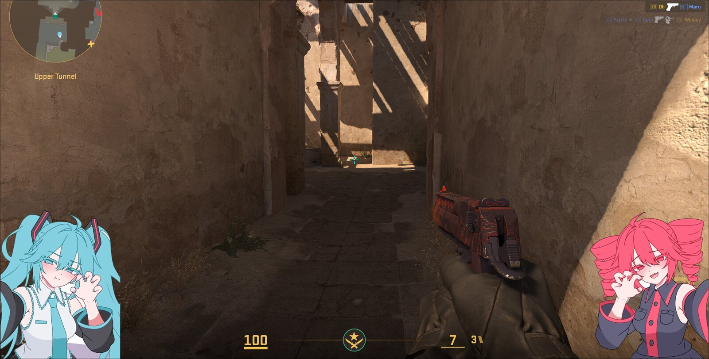
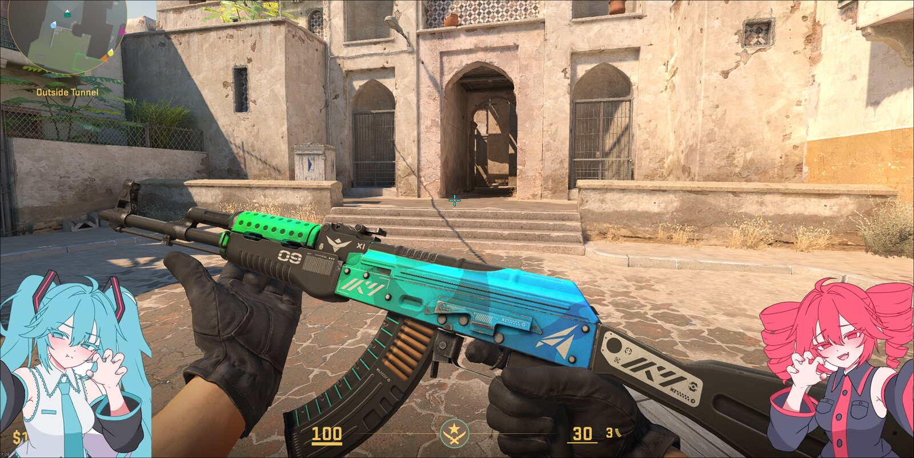
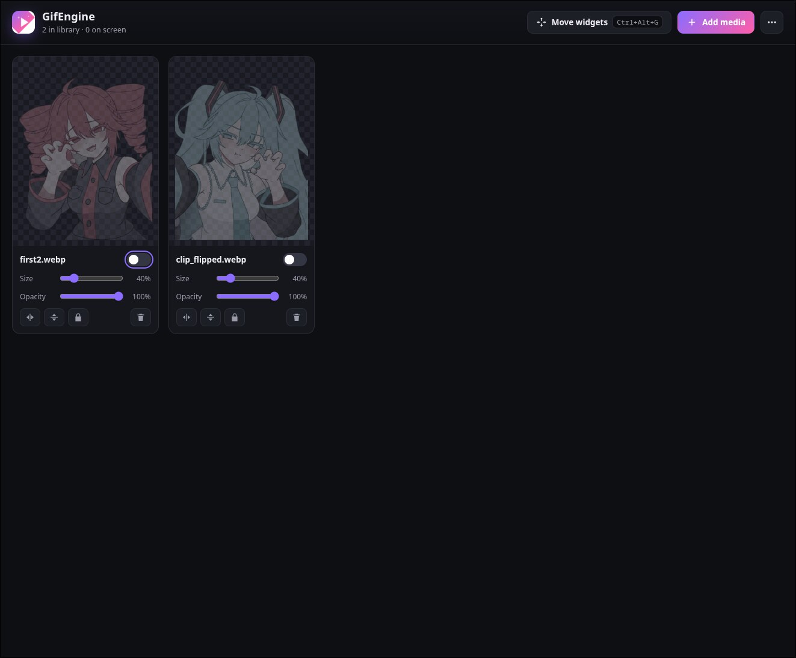

<p align="center"></p>

<p align="center"><b>GifEngine</b><br>Animated GIFs, WebPs and videos on your desktop.<br>Transparent, click-through, on top of everything (even games) or down on your wallpaper.</p>





**Download**

Get the file for your computer from **[Releases](https://github.com/SunqdXX/GifEngine/releases/latest)**, open it, done.

- **Windows:** `GifEngine-…-win-x64.exe`. If Windows says "Windows protected your PC", click **More info**, then **Run anyway**. Prefer no install? Use `GifEngine-…-portable.exe`.
- **macOS:** the `.dmg` (`arm64` for Apple Silicon, `x64` for Intel). Drag GifEngine into Applications. The first time, open **System Settings → Privacy & Security** and click **Open Anyway**.
- **Ubuntu, Debian, Mint:** the `.deb`. Double-click it to install.
- **Other Linux:** the `.AppImage`. Right-click it, **Properties → Allow executing as a program**, then double-click it.

**How to use**

1. Open GifEngine and click **Add media**, or drop files onto the window.
2. Flip the switch on a card to put that GIF on your screen.
3. Pick **On top** to keep it above every window, or **Desktop** to put it on your wallpaper under your apps.
4. Click **Move widgets** (or press `Ctrl+Alt+G`, `⌘⌥G` on Mac), drag your GIFs anywhere, scroll over one to resize it, then click **Done**.

Size, opacity, flip and lock are on each card. Everything is remembered for next time. Closing the window keeps your GIFs on screen; open GifEngine again to get it back. Quit is in the `⋯` menu.

**Linux notes**

GifEngine runs through XWayland automatically and works out of the box on Hyprland. On Wayland, the Desktop option needs [quickshell](https://quickshell.org) installed.

**Build it yourself**

```
npm ci
npm run dev
npm run dist
```

MIT License
